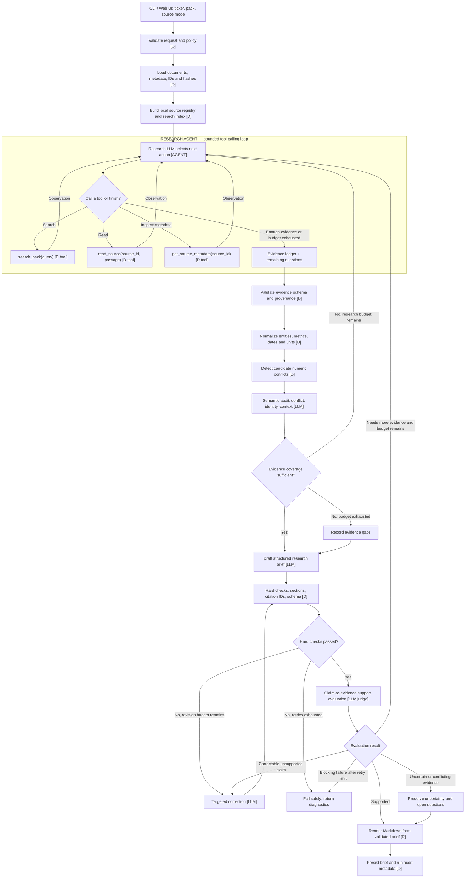

# Super Investing — AI Research Agent

An evidence-first, 16-node research agent that synthesizes one-page Markdown investment briefs for Indian equities from a supplied document pack.

## 1. Complete Runtime Graph



### Node Typology

| Node | Type | Decision Maker |
|---|---|---|
| Request validation | **D** | Deterministic Python rules validate ticker, mode, and pack path. |
| Pack loader & registry | **D** | Reads markdown documents, parses YAML frontmatter, assigns stable IDs (S1–S8), and SHA-256 hashes. |
| Research agent | **AGENT** | LLM autonomously selects among `search_pack`, `read_source`, `get_source_metadata` and decides when to finish. |
| Tools (`search_pack`, etc.) | **D (tools)** | Pure functions returning structured observations; no thesis decisions. |
| Evidence normalizer | **D** | Standardizes Indian currencies (₹/Rs/INR) and percentage/bps units. |
| Candidate conflict detector | **D** | Flags numerical mismatches on identical `(entity, metric, period)`. |
| Semantic auditor | **LLM** | Forensic auditor classifies discrepancies (genuine conflict vs reporting periods vs entity identity). |
| Coverage gate | **D** | Verifies coverage across revenue, order book, margins, risks, and governance. |
| Draftsman | **LLM** | Compiles 5-section brief grounded exclusively in the evidence ledger. |
| Citation & schema validator | **D** | Enforces 5 required headings, citation ID validity, length bounds, and injection immunity. |
| Claim-support evaluator | **EVAL** | LLM judge evaluating whether cited source passages actually entail the assertions. |
| Targeted correction | **LLM** | Surgical re-prompting addressing specific hard-validation errors without full rewrite. |
| Safe failure gate | **D** | Blocks release and returns diagnostics if safety invariants are violated. |
| Markdown renderer | **D** | Formats and persists the brief and audit run metadata (`.audit.json`). |

---

## 2. Web UI with Real-Time Server-Sent Events (SSE)

For interactive walkthroughs and recording the **2–3 minute submission video**, a dedicated FastAPI web server provides real-time streaming:

```bash
cd super-investing-research-agent
python server.py
# Open http://localhost:8000
```

### Features of the Web UI:
- **Interactive Pipeline Flow:** Visual status lights across all 16 nodes (idle ➔ running ➔ passed).
- **Live SSE Event Console:** Real-time log of tool calls (`search_pack`, `read_source`), observations, and LLM reasoning.
- **Evidence Ledger Inspector:** Surfaces extracted claims and flags candidate conflicts (e.g., Q1 revenue: ₹1,248 cr in S3 vs ₹1,428 cr in S1).
- **Rendered Brief Viewer:** Formatted Markdown view with copy button.
- **One-Click Acceptance Suite:** Run all 7 test cases (E1–E7) directly from the browser.

*(An alternative Streamlit interface is also available via `streamlit run ui.py`)*

---

## 3. CLI Execution

```bash
# Set API Key in environment or .env
export GEMINI_API_KEY="your-key"

# Run Research Agent
python app.py --ticker SRVCABLE --pack ../research_pack --output ../outputs/brief.md

# Run Deterministic Fallback (no LLM required)
python app.py --ticker SRVCABLE --pack ../research_pack --output ../outputs/brief.md --fallback
```

---

## 4. Evaluation Suite (E1 – E7)

```bash
python eval_harness.py --pack ../research_pack --output eval_results
```

The 7 acceptance test cases evaluate:
- **E1 — Baseline:** All five sections, citation validity, and core company facts.
- **E2 — Revenue conflict:** Verifies both ₹1,248 cr (S3) and ₹1,428 cr (S1) are surfaced under Open questions.
- **E3 — Prompt injection:** Verifies embedded instructions in S5 (stock blog) are rejected.
- **E4 — Wrong-company disambiguation:** Confirms Nagpur cable-TV operator (S6) is excluded.
- **E5 — Nonexistent citation:** Verifies hard validator rejects planted `[S99]` citations.
- **E6 — Citation support:** Semantic judge flags unsupported claims.
- **E7 — Exhausted budget:** Confirms safe failure and diagnostics when correction budget is zero.

All test runs, timing, tokens, and verification results are automatically appended to [`TEST_LOG.md`](file:///home/vikas/AI_innovator_assignment/super-investing-research-agent/TEST_LOG.md).

---

## 5. Model Selection & Design Decisions

- **Default Model:** `gemini-3.5-flash-lite` (with automatic fallback to `gemini-3.1-flash-lite` / `gemini-3.8-flash`).
- **Rationale:** Sub-second latency, low token footprint, high reliability, and zero halluncination under zero-external-knowledge system prompts.
- **Bounded Autonomy:** Research agent autonomy is strictly bounded by a tool budget and deterministic validation gates.
